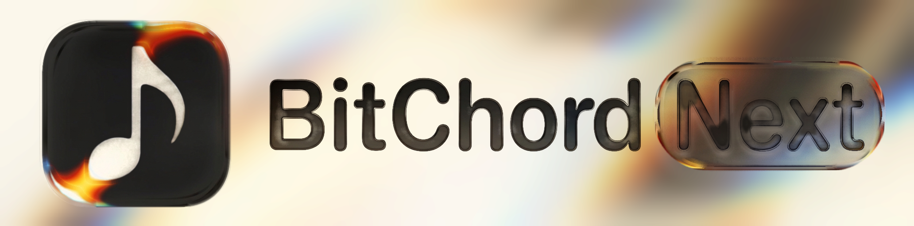

<div align="center">

<br/>
<br/>



# BitChord Next

### Free, lossless-first music — a community fork of BitChord

<br/>

[](https://github.com/OreoMuncher45/BitChord/releases)
[](https://github.com/OreoMuncher45/BitChord/blob/main/LICENSE)
[](https://github.com/OreoMuncher45/BitChord/releases)

<br/>

[**Download**](#download) · [**Extra features**](#extra-features) · [**Lossless addons**](#lossless-addons) · [**Support**](#support) · [**Disclaimer**](#disclaimer)

<br/>

> [!IMPORTANT]
> BitChord Next is **free** and built on top of [BitChord](https://github.com/kushagrasinghx/BitChord) by [kushagra](https://github.com/kushagrasinghx) — credit for the app goes to him. If it earns a spot in your rotation, consider tipping him on [Ko-fi](https://ko-fi.com/kushagrasinghx). This fork adds the features below and is maintained by [OreoMuncher45](https://github.com/OreoMuncher45).

</div>

> [!NOTE]
> BitChord Next is not affiliated with, endorsed by, or connected to YouTube or Google in any way. Use it at your own discretion.

---

<div align="center">


<h1><a id="extra-features"></a>Extra features (on top of everything BitChord does)</h1>

Everything upstream BitChord ships — search, playback, downloads, lyrics, Discord presence, scrobbling — plus:

#### Flow
- **Deezer-style endless personal mix** — unlocks at 16 favorites, moods, discovery slider, genre tuner, trains on skips and bans.
- **One mix stays, refreshes hourly**, survives restarts, never autoplays until you press play.

#### Classipod
- **Full iPod Classic theme** — click-wheel navigation, Cover Flow, A–Z search, Now Playing modes, per-page wheel slots.

#### Sound
- **Automix V2** — DJ-style transitions with entrance rescoring and vocal gating.
- **Sing (karaoke)** — turn the lead vocal down and sing over the track, mic button in lyrics.
- **Honest lossless numbers** — stats-for-nerds and Discord show the PCM decode rate (1411/4608), never a bogus container figure.

#### Library & downloads
- **Downloads play at your settings quality when online**, file stays the offline path with failure fallback.
- **Instant downloads screen** — snapshot first paint, memoized reopen, batched verification, single-song cache updates.
- **Save cover art** from any song menu.

<h1><a id="lossless-addons"></a>Lossless addons</h1>

Extra sources under Sources, each with health checks and honest failure states:

- **BitChord NEXT** — Tidal Hi-Fi FLAC via community instances with automatic failover and daily list refresh.
- **BitChord Hi-Res** — direct measured FLAC files, no converter, no account, no waiting.
- **BitChord Qobuz** — Qobuz catalogue search plus queued FLAC conversions up to 24/192. One in-app-browser unlock mints a resuming session; the row tells you when it needs renewing or the converter is down.
- Stream refusals report themselves on the Sources rows instead of failing silently.

</div>

---

<div align="center">

<h1><a id="download"></a>Download</h1>

Grab the latest signed APK from the [Releases](https://github.com/OreoMuncher45/BitChord/releases) page — `arm64-v8a` fits almost all modern phones (`armeabi-v7a`, `x86_64` and `universal` are there too). Sideloading requires enabling "Install unknown apps" for whichever app you download it with. Updates install over the old build; your library, downloads and settings carry over.

</div>

---

<div align="center">

<h1><a id="support"></a>Support</h1>

BitChord Next is free and open source, and it's staying that way. No telemetry, no accounts, no ads, no "Pro" tier, and no plan to add one.

If you enjoy using it and want to throw a few bucks toward development, you can do so here:

| Asset | Address |
|---|---|
| **Nano (XNO)** — instant, feeless, no minimum | `nano_1zqdw3qf1z8k3jx8jintaiwpo3yz7zqh1me4ph5j439ts8hsppx8dzy4xcsz` |
| **USDC on Base** (EVM) | `0x3f262ee685ced4a8270cece45ebdfdb2b18f54b5` |
| **Zcash (ZEC)** — shielded unified address | `u1z9k30yyvy63f5w0jypt02kvvw6dcpcgprlhzmsgc57mw6qc8rtuc5tfd9ny4atqhr448udexhkuc8xgl0z5rd9njuxnwl7kh2ahqwcqlydt9dpr4t40eawr5st74as5jed669993epsnwuejnrwv4yrkx065pqvmt0cr8gdwggcv2djp` |

<details>
<summary><b>Copy-paste block</b></summary>

```
XNO (Nano):
nano_1zqdw3qf1z8k3jx8jintaiwpo3yz7zqh1me4ph5j439ts8hsppx8dzy4xcsz

USDC (Base / EVM):
0x3f262ee685ced4a8270cece45ebdfdb2b18f54b5

ZEC (shielded unified address):
u1z9k30yyvy63f5w0jypt02kvvw6dcpcgprlhzmsgc57mw6qc8rtuc5tfd9ny4atqhr448udexhkuc8xgl0z5rd9njuxnwl7kh2ahqwcqlydt9dpr4t40eawr5st74as5jed669993epsnwuejnrwv4yrkx065pqvmt0cr8gdwggcv2djp
```

</details>

> **Why crypto only?** GitHub Sponsors doesn't pay out in Pakistan, and most conventional payment processors won't either — crypto is just what works.

The upstream author takes tips on [Ko-fi](https://ko-fi.com/kushagrasinghx) — without his BitChord, none of this exists.

Anything is appreciated, nothing is expected. A star, a bug report, or a pull request is just as welcome.

</div>

---

<div align="center">

<h1><a id="disclaimer"></a>Disclaimer & Legal Notice</h1>

BitChord Next is an independent, community-driven fork. It is **not** associated with Google LLC, YouTube Music, Deezer, Qobuz, Tidal, Telegram, or any of their parent companies.

* **No Media Hosting:** BitChord Next does not host, upload, or store copyrighted music files. It operates strictly as an interface to scan local device storage or stream media directly from public, public-facing, or user-authenticated APIs.
* **Fair Use & API Usage:** This software is created solely for personal research, educational, and fair-use purposes. The user is entirely responsible for ensuring their usage aligns with their local copyright laws and the terms of service of any service used.
* **Copyleft:** BitChord Next is free software under the GPLv3. The license does not let anyone forbid others from selling or redistributing copies, but any distribution must come with the Corresponding Source under the same license.

</div>

---

<div align="center">

<h1><a id="license"></a>License</h1>

This project is licensed under the **GNU General Public License v3.0 (GPLv3)**. See the [LICENSE](LICENSE) file for details.

</div>
