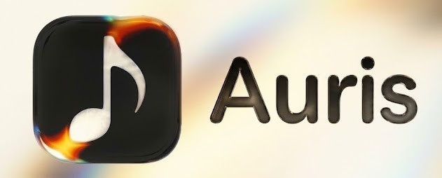
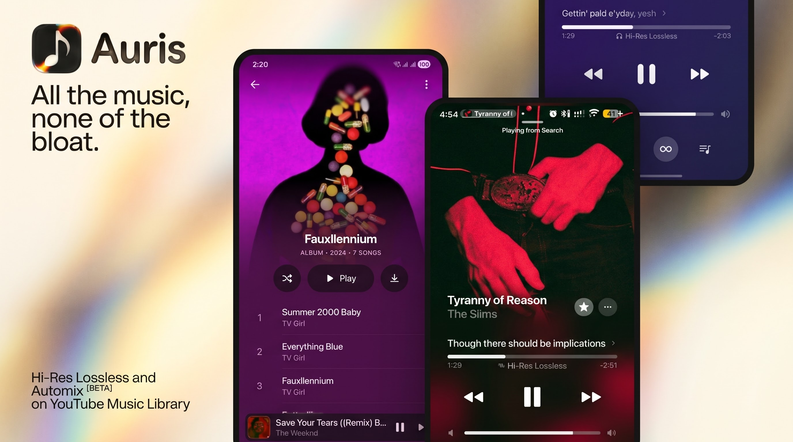

<div align="center">

<br/>



# Auris

### A lossless-first Android music player, rebuilt from BitChord

<br/>

[](https://github.com/OreoMuncher45/BitChordNext/releases)
[](https://github.com/OreoMuncher45/BitChordNext/blob/main/LICENSE)
[](https://github.com/OreoMuncher45/BitChordNext/releases)

<br/>


[**Features**](#features) · [**Sources & addons**](#sources--addons) · [**Download**](#download) · [**Build from source**](#build-from-source) · [**Support**](#support) · [**Credits & license**](#credits--license)

</div>

> [!IMPORTANT]
> Auris is a community fork of [BitChord](https://github.com/kushagrasinghx/BitChord) by [kushagra](https://github.com/kushagrasinghx) — the original app is his work, and credit belongs to him. This fork adds the interface and features described below and is maintained by [OreoMuncher45](https://github.com/OreoMuncher45).

> [!NOTE]
> Auris is not affiliated with, endorsed by, or connected to YouTube, Google, Deezer, Qobuz, Tidal, or any other service mentioned here.

---

## What Auris is

A free Android music player built around **lossless-first playback**. It plays your local library, YouTube Music, and optional lossless addons, with the same library, downloads, lyrics, scrobbling and Discord presence you expect from a modern player.

Android only. No ads, no telemetry, no account required, no "Pro" tier.

## Features

### Interface
- **Apple Music–style layout** — full-bleed Now Playing, large artwork, and a seeded palette that follows the current cover.
- **Folding glass navigation** — one bar that folds as you scroll, with a search pill that now docks directly on top of the keyboard.
- **Customisation hub** — pin colours for buttons, seekbar, text and lyrics, or leave them on Automatic. Automatic ink uses the artwork's own average colour, nudged brighter or darker so it stays legible.
- **Light and dark themes**, reduced motion, and Home/Library layout toggles.

### Listening
- **Flow** — an endless personal mix that unlocks at 16 favourites, trains on skips and bans, refreshes hourly, survives restarts, and never autoplays until you press play.
- **Classipod** — a full iPod Classic theme with click-wheel navigation and Cover Flow.
- **Automix V2** — DJ-style transitions with beat locking, entrance rescoring and vocal gating.
- **Sing** — karaoke mode that turns the lead vocal down so you can sing over the track.
- **Honest lossless numbers** — stats and Discord presence report the decoded PCM rate (1411 / 4608 kbps), never a container guess.
- **AI badge with strict mode** — flags AI-generated uploads and can skip them.

### Library & downloads
- **Downloads play at your chosen quality when online**, with the downloaded file kept as the offline fallback.
- **Instant downloads screen** — snapshot first paint, batched verification, single-song cache updates.
- **Save cover art** from any song menu.
- **Replay** appears in Library through a Customisation toggle instead of taking over Home.

## Sources & addons

Auris ranks sources itself: your addons first, then JioSaavn if you opt in, then YouTube Music as the fallback. Each addon has a health check and reports stream refusals on its own row instead of failing silently.

Three built-in lossless addons ship with the app:

| Addon | What it does |
|---|---|
| **Auris Addon** | Hi-Fi FLAC through community instances, with automatic failover and a refreshed instance list. |
| **Auris Hi-Res Lossless Addon** | Direct FLAC files at measured quality — no converter, no account, no waiting. |
| **Auris Qobuz Addon** | Catalogue search plus queued FLAC conversions up to 24/192. One in-app unlock starts a resuming session and the row tells you when it needs renewing. |

Those three names belong to the sources Auris ships, and only those are permanent. **Anything you add yourself stays yours**: it is listed under its own name or host, and it can always be deleted — including links that happen to speak one of the built-in protocols. Adding an addon never creates a second "Auris" row.

> **Why the addons aren't named after their backends:** they run on volunteers' servers and free tiers. Naming them draws traffic, and traffic gets things rate-limited or shut down. The endpoints, fallbacks and setup steps are all in the source for anyone who wants to look.

## Download

Grab the latest signed APK from the [Releases](https://github.com/OreoMuncher45/BitChordNext/releases) page. Current build: **2.2.17** (`versionCode 79`, package `com.dev.bitchord`).

| APK | Use it for |
|---|---|
| `Auris-v8a-release.apk` | Almost every modern phone (recommended). |
| `Auris-v7a-release.apk` | Older 32-bit devices. |
| `Auris-x86_64-release.apk` | Emulators and x86 Chromebooks. |
| `Auris-universal-release.apk` | If you aren't sure which one you need. |

- Sideloading requires enabling "Install unknown apps" for whichever app you download it with.
- Every release is signed with the same key, so updates install over the old build. Your library, downloads and settings carry over.
- Requires Android 8.0 (API 26) or newer.

## Build from source

This fork is developed for Android. The desktop and backend trees remain upstream code and are not part of the Auris build.

```bash
# JDK 21 and the Android SDK (compileSdk 37) are required.
./gradlew :app:assembleDebug          # debug build
./gradlew :app:assembleDevRelease     # minified, R8-optimised release build
```

A signed, installable release APK is produced by the **Flow Debug APK** workflow (Actions → Run workflow). It signs with the fork's stable key so it updates over previous installs. Last.fm credentials are optional and read from `local.properties`; scrobbling stays unavailable until they are provided.

## Support

Auris is free and open source, and it is staying that way. A star, a bug report or a pull request is appreciated as much as a donation.

- [Discord](https://discord.gg/8VnWqcuzqg) · [Reddit](https://reddit.com/r/BitChordNext) · [Issues](https://github.com/OreoMuncher45/BitChordNext/issues)

| Asset | Address |
|---|---|
| **Nano (XNO)** — instant, feeless, no minimum | `nano_1zqdw3qf1z8k3jx8jintaiwpo3yz7zqh1me4ph5j439ts8hsppx8dzy4xcsz` |
| **USDC on Base** (EVM) | `0x3f262ee685ced4a8270cece45ebdfdb2b18f54b5` |
| **Zcash (ZEC)** — shielded unified address | `u1z9k30yyvy63f5w0jypt02kvvw6dcpcgprlhzmsgc57mw6qc8rtuc5tfd9ny4atqhr448udexhkuc8xgl0z5rd9njuxnwl7kh2ahqwcqlydt9dpr4t40eawr5st74as5jed669993epsnwuejnrwv4yrkx065pqvmt0cr8gdwggcv2djp` |

<details>
<summary><b>Copy-paste block</b></summary>

```
XNO (Nano):
nano_1zqdw3qf1z8k3jx8jintaiwpo3yz7zqh1me4ph5j439ts8hsppx8dzy4xcsz

USDC (Base / EVM):
0x3f262ee685ced4a8270cece45ebdfdb2b18f54b5

ZEC (shielded unified address):
u1z9k30yyvy63f5w0jypt02kvvw6dcpcgprlhzmsgc57mw6qc8rtuc5tfd9ny4atqhr448udexhkuc8xgl0z5rd9njuxnwl7kh2ahqwcqlydt9dpr4t40eawr5st74as5jed669993epsnwuejnrwv4yrkx065pqvmt0cr8gdwggcv2djp
```

</details>

## Credits & license

- **BitChord** by [kushagra](https://github.com/kushagrasinghx) — the app this fork is built on. If you redistribute Auris, keep that credit.
- Everyone whose libraries and community services make the addons possible.
- Third-party components and their licences are listed in [NOTICE](NOTICE).

Auris is free software under the **GNU General Public License v3.0**. You may use, study, share and modify it, including commercially, but any distribution must keep this credit and ship the corresponding source under the same licence. See [LICENSE](LICENSE).

## Disclaimer

Auris is an independent, community-driven fork. It is **not** associated with Google LLC, YouTube Music, Deezer, Qobuz, Tidal, or any of their parent companies.

- **No media hosting.** Auris does not host, upload or store copyrighted music. It is an interface to local storage and to user-authenticated or public APIs.
- **Fair use and API usage.** The software is provided for personal research, educational and fair-use purposes. You are responsible for complying with your local copyright law and the terms of any service you connect.
- **No warranty.** Provided as is, without warranty of any kind. Use it at your own discretion.
